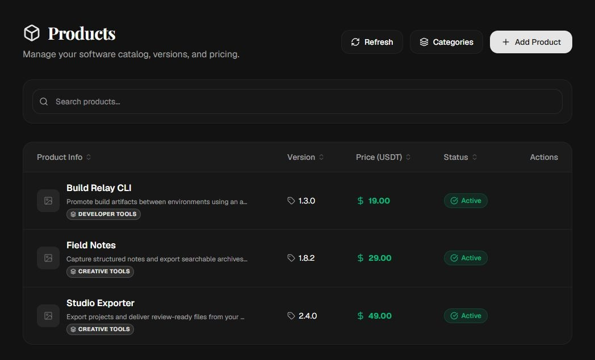
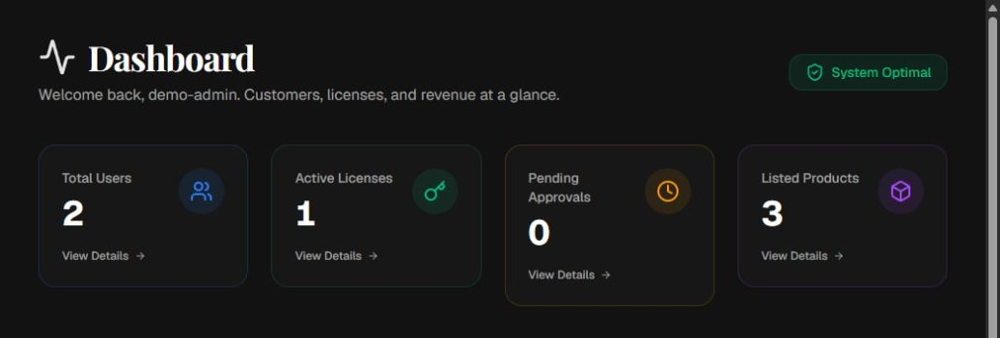
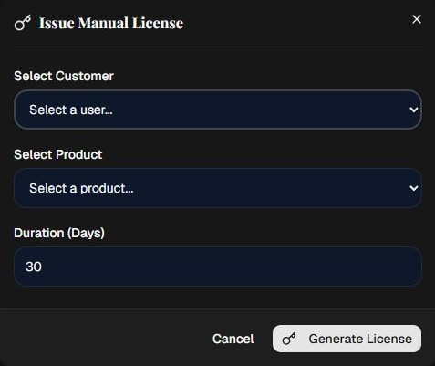
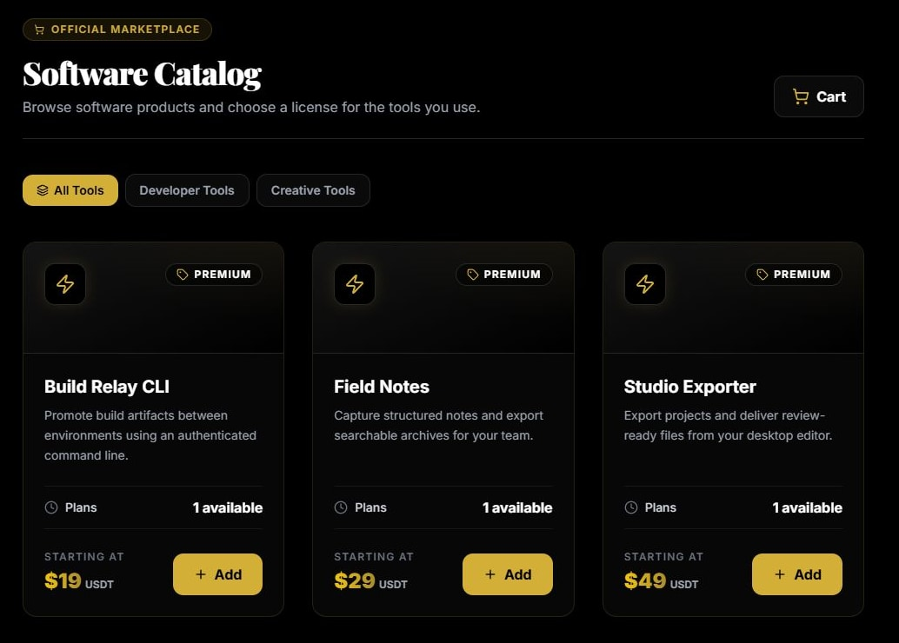

# FXCRUX License Engine

FXCRUX License Engine is a self-hosted software licensing server for desktop apps, plugins, and command-line tools. Run it with your own PostgreSQL database, issue keys from the admin dashboard, and have your app validate licenses over HTTP. Customers can sign in to view their licenses and download eligible releases.

Try the [Node.js example](examples/node/check-license.mjs) or the [PowerShell example](examples/powershell/check-license.ps1). The [integration guide](docs/INTEGRATION.md) shows the request and response contract for other clients.

## Screenshots

These views use an isolated demo database with sample software products.



<details>
<summary>Admin overview, license issuance, and customer catalog</summary>







</details>

## Project layout

| Path | What belongs there |
| --- | --- |
| `apps/api` | NestJS licensing API, product catalog, and PostgreSQL persistence |
| `apps/admin` | Administrator dashboard for products, releases, users, and licenses |
| `apps/portal` | Customer portal for licenses, downloads, and support |
| `examples` | Standalone clients for the public HTTP API |
| `integrations` | Optional Windows engine and original platform adapters |

The licensing API can issue and validate keys without a checkout. The inherited commerce screens use USDT when an operator configures payment wallets.

## Local development

Install Node.js 24 and npm. Use either Docker Compose or a local PostgreSQL instance with an empty database.

From the repository root:

```sh
node apps/api/scripts/setup-local.cjs
docker compose --env-file apps/api/.env up -d --wait
```

For a local PostgreSQL instance, skip the Docker command and set the `DB_*` values in `apps/api/.env` to match that instance. The setup script generates credentials for development and writes them to the ignored environment file. Read the bootstrap administrator credentials from that file. Remove the bootstrap password after the first successful login.

Open a terminal in each application directory, run `npm ci`, then start the service:

| Directory | Start command | Local address |
| --- | --- | --- |
| `apps/api` | `npm run start:dev` | `http://127.0.0.1:3000` |
| `apps/portal` | `npm run dev -- --port 3001` | `http://localhost:3001` |
| `apps/admin` | `npm run dev -- --hostname 127.0.0.1 --port 3002` | `http://localhost:3002/admin-login` |

The web apps default to the local API address. Set `BACKEND_URL` in each app's `.env.local` when using a different address. `PORTAL_URL` sets the portal's canonical origin. The database schema synchronization enabled by the setup script is intended for disposable development databases. See [Security](SECURITY.md) before exposing a deployment.

## Verify changes

Run `npm run build` in each affected app and `npm test -- --runInBand` in `apps/api`. See [project status](PROJECT_STATUS.md) for verification coverage and release work.

## Contribute

Fork the repository, open a pull request, and explain the behavior and how you verified it. Ali Davodi reviews changes for the official project and publishes official releases. See [Contributing](CONTRIBUTING.md) and [Contributors](CONTRIBUTORS.md).

See [GitHub launch notes](docs/PUBLISHING.md) for repository metadata and release preparation.

Copyright © 2026 Ali Davodi. The project source is available under [Apache-2.0](LICENSE). See [NOTICE](NOTICE) for attribution and the maintainer's contact. The license does not grant trademark rights.
